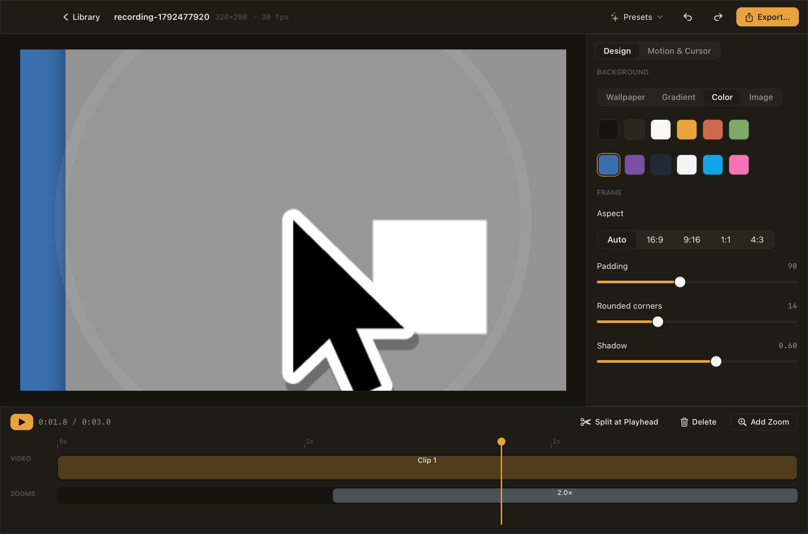

# nanostudio

<p align="center">
  
</p>

A screen recorder and editor for macOS, built on [nanoui](https://github.com/justrach/nanoui) in Zig, in Codegraff's colors. It follows [Shitty Screen Studio](https://github.com/hewliyang/shitty-screen-studio) by [Li Yang](https://github.com/hewliyang), with his permission, by way of [Recorder](https://github.com/justrach/shitty-screen-studio).

Record a display or a window. nanostudio logs your cursor and clicks as you go, so the edit can zoom where you worked. Then trim, speed up, dress and export.

- **Capture:** a floating capture bar, as Screen Studio's. It records a display or one window. ScreenCaptureKit records into HEVC, with the system's sound and the microphone (macOS 15) as AAC tracks. The system cursor is left out, because nanostudio draws its own. The bar stays out of the recording.
- **Library:** recordings live in `~/Movies/Shitty Screen Studio`, the same library the reference uses, in the same format (`screen.mp4` and `recording.json`). Recordings made with either app open in the other.
- **Timeline:** split at the playhead, remove clips, trim a clip by dragging its edges, and set a clip's speed from 0.5× to 4×. Undo and redo.
- **Zooms:** made automatically from your clicks, or added, resized and deleted by hand. The camera pushes in toward the click, follows the cursor with a dead zone, and eases out, as the reference's motion does.
- **Design:** a background of macOS wallpapers, gradients, colors or your own picture, with a blur. Then the canvas's aspect ratio, padding, roundness and shadow. Presets set the look in one click, and each slider resets.
- **Sound:** what was recorded plays along in the editor and goes into the export, cut and sped up with the timeline.
- **Motion:** the interface moves with nanoui's `ui.motion`. Takes come in one by one, menus spring open, tabs slide and zooms pop in.
- **Cursor:** spring-smoothed, in black, white or amber, at any size, with click ripples.
- **Export:** an H.264 MP4 at 1080p, drawn by the same view as the preview, so what you see is what you get.

Requires macOS 13 or later on Apple silicon.

## Build

```sh
zig build run                     # against the pinned nanoui
zig build test --fork=../..       # inside a nanoui checkout, against it
VERSION=0.1.0 sh macos/package.sh # nanostudio.app and a disk image
```

Open the app bundle rather than the bare binary, so that Screen Recording permission belongs to nanostudio and not to your terminal. `nanostudio <recording folder>` opens a recording in the editor.

## How it's made

Every frame is a nanoui view (`src/canvas.zig`): the background, the screen with its corners and shadow, the zoom, the ripples and the cursor. In the editor it draws the preview. In export, nanoui renders it offscreen and the pixels go to the encoder. Video frames reach nanoui as textures: each CVPixelBuffer is wrapped for Metal without a copy (`ui.texture`).

AVFoundation, CoreMedia, CoreVideo and ScreenCaptureKit are called directly through nanoui's Objective-C runtime, with no headers and no shims.

The tests use videos they generate in temporary folders and never capture the screen. They cover the model, motion, decoding and encoding, the canvas, an edited export, and the editor through its views.

## Not yet

Compared with the reference, nanostudio doesn't yet have:
- the webcam and the event (self-recording) mode
- area capture
- the keystroke overlay
- motion blur
- the Codegraff edit assistant

## Credits

- **[Li Yang](https://github.com/hewliyang)** ([@hewliyang](https://github.com/hewliyang)) made [Shitty Screen Studio](https://github.com/hewliyang/shitty-screen-studio), and nanostudio follows it with his permission. That covers its camera motion (the push in, the dead zone, the ease out), auto-zooms from clicks, the stop-button trim, the style settings and the recording format. He's a contributor to this project. See [third-party notices](THIRD_PARTY_NOTICES.md).
- **[nanoui](https://github.com/justrach/nanoui)** draws everything, from the canvas to the motion.
- [Screen Studio](https://screen.studio) for the look of a capture bar and an editor that zooms where you clicked.
